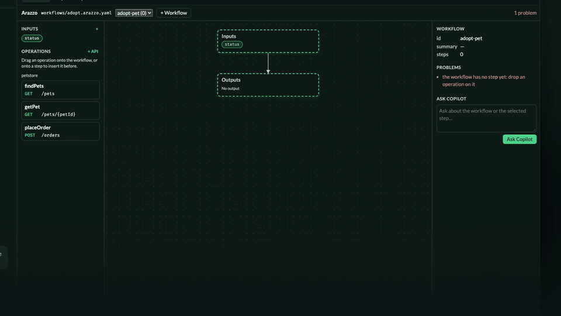
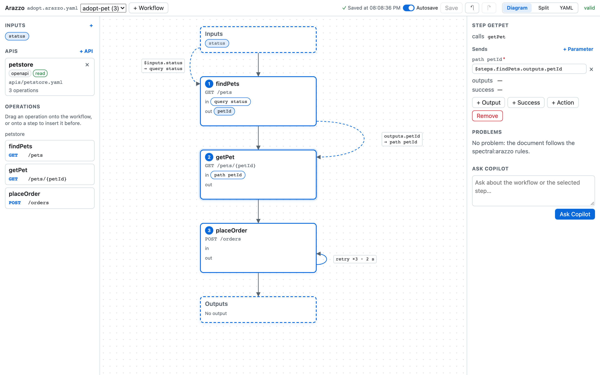
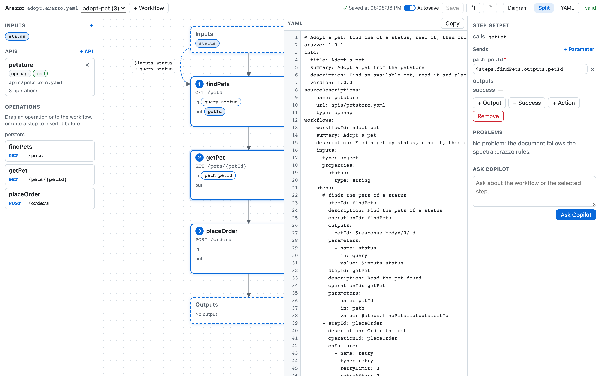

<div align="center">

# Arazzo canvas for GitHub Copilot

**Design [Arazzo](https://spec.openapis.org/arazzo/latest.html) API workflows visually, right inside GitHub Copilot.**

[](https://github.com/SebastienDegodez/github-copilot-arazzo/actions/workflows/ci.yml)
[](https://github.com/SebastienDegodez/github-copilot-arazzo/releases)
[](#quality)
[](#quality)
[](https://github.com/semantic-release/semantic-release)
[](LICENSE)

</div>

[](https://youtu.be/a2Bo--ZJRjw)

Watch the [56 s video on YouTube](https://youtu.be/a2Bo--ZJRjw), with sound and English or French
subtitles: drag operations from an API, wire values, then ask Copilot to finish the workflow on the
same canvas. The file is also in [docs/media](docs/media/arazzo-canvas.mp4).



## Why

An Arazzo document describes how API calls chain together: which operation runs first, what each
step sends, which response values flow into the next step, when to retry or stop. Writing it by
hand means juggling `operationId`s, runtime expressions such as `$steps.findPets.outputs.petId`,
and a specification you rarely keep in your head.

This plugin adds an **`arazzo` canvas** to GitHub Copilot. You build the workflow by dragging the
operations of your OpenAPI descriptions; the canvas writes valid Arazzo YAML, checks it against the
[`spectral:arazzo`](https://docs.stoplight.io/docs/spectral/docs/reference/arazzo-rules.md) rules as
you go, and Copilot can read and edit the same workflow from the chat.

## Features

| | |
|---|---|
| 🧭 **Visual flow chart** | Inputs → steps → outputs, with data edges for the values each step receives, and retry loops, `goto` jumps and `end` exits drawn on each step — after the Arazzo diagram of [Microcks](https://microcks.io). |
| 🖱️ **Drag and drop** | Drop an operation to add a step (onto a step to insert it before), drag a step to reorder, drag an input or a step output onto a parameter to pass it on. |
| ✏️ **Step inspector** | Every parameter of the operation with its value — fixed or a runtime expression — plus extra headers and JSON body properties; click an empty slot to fill it. |
| 🔌 **API descriptions** | Each OpenAPI/Arazzo source with its file, type, state and operation count. A source is only added once it can be read (≤ 5 MB); the form proposes the description files of your workspace. |
| ✅ **Live validation** | The full `spectral:arazzo` ruleset (errors and warnings) plus what only the canvas knows — unknown operations, values read from a later step. Each problem has its rule, severity, JSON pointer and line, and is shown on its step. |
| 📝 **YAML view** | Diagram, Split or YAML. The YAML is editable, validated as you type, and is exactly what gets saved — comments and key order preserved. |
| 💾 **Your save model** | Autosave on: every edit is written at once. Off: edit a draft, save with **Save** or <kbd>Ctrl</kbd>/<kbd>⌘</kbd>+<kbd>S</kbd>. Undo/redo everything. External file changes are picked up, with a conflict prompt when you have unsaved edits. |
| 💬 **Ask Copilot** | Ask about the workflow or the selected step: the question reaches the chat with the step, its problems and the document path, and Copilot answers by editing the canvas. |



## Installation

Requires the [GitHub Copilot CLI](https://docs.github.com/copilot/how-tos/use-copilot-agents/use-copilot-cli)
(or the GitHub Copilot app) with plugin support, and Node.js 22 or later.

```sh
copilot plugin marketplace add SebastienDegodez/github-copilot-arazzo
copilot plugin install arazzo@github-copilot-arazzo
```

The plugin ships with no runtime dependency.

## Usage

Ask Copilot:

> Open the Arazzo canvas on `flows/adopt.arazzo.yaml` using the API in `apis/petstore.yaml`.

or open the canvas directly:

```json
{ "canvasId": "arazzo", "input": { "path": "flows/adopt.arazzo.yaml",
  "sources": [{ "name": "petstore", "url": "apis/petstore.yaml" }] } }
```

| Input | Meaning |
|---|---|
| `path` | Arazzo document, relative to the workspace. Created with one empty workflow when missing; defaults to the first `*.arazzo.yaml` found. |
| `workflowId` | Workflow to show, or the id given to the workflow of a new document. |
| `sources` | OpenAPI descriptions a new document calls, `url` relative to the document. |

### Driving the canvas from Copilot

The bundled `arazzo-workflow-authoring` skill teaches the agent to edit through the canvas actions,
so every change appears on the diagram and is refused with a reason when it would break the
workflow:

`get_workflow` · `select_workflow` · `add_workflow` · `add_source` · `remove_source` ·
`list_source_candidates` · `add_step` · `move_step` · `remove_step` · `add_input` ·
`set_step_value` · `clear_step_value` · `set_step_output` · `link_data` · `add_workflow_output` ·
`add_success_criterion` · `add_action` · `save` · `undo` · `redo` · `set_autosave` · `get_yaml` ·
`set_yaml`

Your autosave preference is stored in
`$COPILOT_HOME/extensions/arazzo-canvas/artifacts/settings.json` (`~/.copilot` by default).

## Architecture

Clean Architecture, enforced by a test on the import graph:

```
com.github.copilot/extensions/arazzo-canvas/extension.mjs   ← only file importing the Copilot SDK
src/composition.mjs                                         ← composition root
src/presentation/      canvas declaration, actions, loopback server (token + SSE), panel UI
src/infrastructure/    workspace files, HTTP sources, preferences, comment-preserving YAML codec
src/arazzo-application/studio.mjs                           ← use cases behind ports
src/arazzo-domain/     edits, spectral:arazzo rules, schema, catalog, history, layout — pure
```

YAML is handled by a vendored copy of [`yaml`](https://eemeli.org/yaml/) (ISC). The panel is served
on `127.0.0.1` only, and every mutating call carries a per-process token.

## Quality

Developed with the [SKRAFT](https://github.com/SebastienDegodez/skraft-plugin) engineering
practices: Gherkin scenarios first (`features/`), outside-in TDD, and blocking quality gates.

| Gate | Tool | Bar |
|---|---|---|
| Acceptance, integration, architecture | `node --test` | all green |
| Browser behaviour and `@visual` scenarios | Playwright | all green |
| Line coverage | Node test coverage | 100 % lines, ≥ 95 % branches and functions |
| Mutation — domain & application | StrykerJS | 100 % |
| Mutation — infrastructure & presentation | StrykerJS | ≥ 80 % |

```sh
npm ci
npm test                    # acceptance + integration + architecture
npm run test:coverage       # with coverage thresholds, writes coverage/lcov.info
npm run test:e2e            # Playwright (npx playwright install chromium first)
npm run mutation:core       # Stryker, breaks under 100
npm run mutation:boundary   # Stryker, breaks under 80
```

Every gate runs in [CI](.github/workflows/ci.yml) on each pull request.

## Demo video

The video is a page, not a recording: `video/scenario.mjs` plays the story on the plugin's studio
with in-memory ports, and `video/app.jsx` renders every frame as a function of time, with the
canvas styled by `src/presentation/ui/styles.css`. Change the canvas and the video follows. Its
colours and type are those of [sebastiendegodez.github.io](https://sebastiendegodez.github.io).
The exported video, its GIF loop, poster and subtitles are in `docs/media/`.

The soundtrack is made from code too (`video/audio.mjs`): an original music bed and the sound
effects are synthesized, the English narration is spoken by a macOS voice, and ffmpeg mixes them
at −16 LUFS, the music ducked under the voice. The subtitles (English and French, SubRip) are timed
on the spoken voice. `video/timeline.mjs` times picture, sound and subtitles alike.

```sh
npm run video               # serves it: open the printed URL; space plays, m toggles the sound, ← → jump chapters, ?t=12 starts at 12 s
npx playwright install chromium   # once, for the export
npm run video:export        # docs/media/arazzo-canvas.mp4 (1920×1080, 30 fps, AAC), .m4a, .gif, .png and .en/.fr.srt subtitles
npm run video:export -- --from 12 --to 22   # a part only: arazzo-canvas-12-22.mp4
npm run video:audio         # the soundtrack and subtitles only: arazzo-canvas.m4a, .en.srt, .fr.srt
```

The narration needs macOS and the voice *Ava (Enhanced or Premium)*: System Settings >
Accessibility > Read & Speak > System voice ⓘ > English (US) > Ava. Pick another with
`--voice "Zoe"`, or leave it out with `--no-voice` (music and effects only) or `--no-audio`.
The export seeks the page frame by frame (`window.__video.seek(t)`), screenshots it with Playwright
and encodes with ffmpeg (`ffmpeg-static`), so the result does not depend on the machine's speed.

## Releases

Versions are cut automatically by [semantic-release](https://github.com/semantic-release/semantic-release)
from [Conventional Commits](https://www.conventionalcommits.org/) on `main`: `feat` → minor,
`fix`/`perf`/`refactor` → patch, `BREAKING CHANGE` → major. The version is written to `plugin.json`
and `package.json`, and the [changelog](CHANGELOG.md) and GitHub release notes are generated.

## Contributing

Contributions are welcome — see [CONTRIBUTING.md](CONTRIBUTING.md). Please report security issues
as described in [SECURITY.md](SECURITY.md).

## License

[Apache-2.0](LICENSE). The diagram layout is adapted from
[Microcks](https://github.com/microcks/microcks) (Copyright The Microcks Authors, Apache-2.0).
